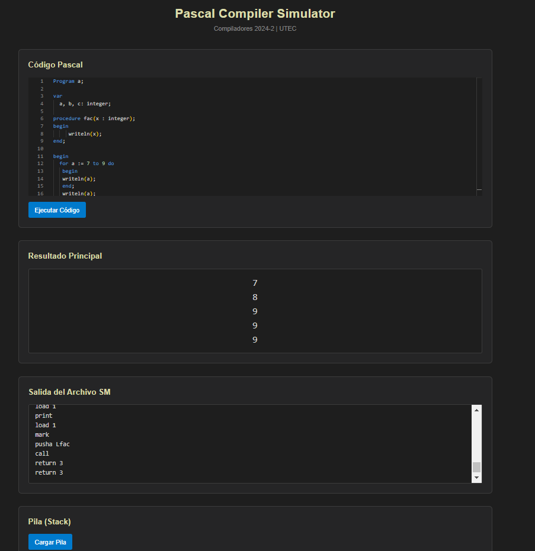

# Simulador de compilador Pascal

Proyecto académico para escribir programas Pascal en una interfaz web y observar la salida del compilador y de la máquina virtual. El frontend usa Next.js y Monaco Editor; el backend usa Flask y ejecuta los programas generados por el compilador C++ de este repositorio.



## Estructura

- `frontend/`: interfaz web.
- `backend/app.py`: API local con los endpoints `POST /compile` y `GET /stack`.
- `compiler/`: compilador, máquina virtual y entradas de ejemplo.

## Requisitos

- Node.js y npm compatibles con `frontend/package.json`
- Python 3 y los paquetes `Flask` y `Flask-Cors`
- `g++` disponible en el PATH

## Uso local

En una terminal, instala las dependencias de Python y levanta la API:

```bash
python3 -m venv .venv
source .venv/bin/activate
pip install -r backend/requirements.txt
python backend/app.py
```

En otra terminal:

```bash
cd frontend
npm ci
npm run dev
```

Abre la dirección local indicada por Next.js. El backend usa por defecto `http://127.0.0.1:5000`.

## Estado y limitaciones

Este repositorio es una demostración académica. El backend compila y ejecuta código proporcionado por el usuario en el mismo equipo y comparte archivos temporales entre solicitudes. **No lo expongas a Internet ni lo uses con código no confiable** sin aislamiento, límites de recursos y manejo seguro de solicitudes concurrentes. Algunas órdenes de ejecución en `backend/app.py` asumen Windows; en macOS/Linux puede requerirse ajustar la invocación del ejecutable generado.

El proyecto conserva artefactos compilados y salidas de ejemplo del trabajo original. La [`.gitignore`](.gitignore) evita agregar nuevos archivos de compilación y entornos locales.

## Contribuir

Incluye pasos para reproducir el cambio y una prueba manual o automatizada. Las correcciones de aislamiento y concurrencia son prioritarias antes de cualquier despliegue público. No se ha definido una licencia de reutilización del código del equipo.
